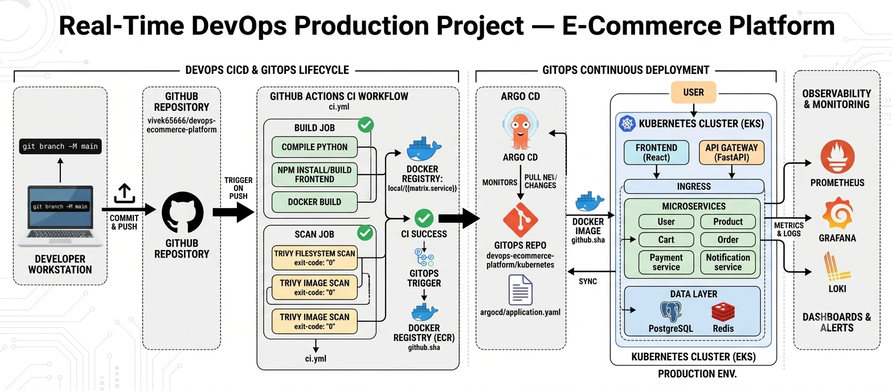

# 🚀 Real-Time DevOps Production Project — E-Commerce Platform

> **Production-style DevOps + DevSecOps + GitOps reference project** for hands-on learning, portfolio work and interviews.

**Stack:** React • FastAPI • Python microservices • PostgreSQL • Redis • Docker • AWS ECR/EKS • Terraform • Kubernetes • Helm • GitHub Actions • Argo CD • SonarQube • Trivy • Prometheus • Grafana • Loki

## What you will build

- React frontend
- FastAPI API Gateway
- User, Product, Cart, Order, Payment and Notification services
- PostgreSQL + Redis foundations
- Docker + Docker Compose
- Kubernetes manifests + Helm
- Terraform AWS VPC/ECR baseline
- GitHub Actions CI/security pipeline
- Argo CD GitOps application
- Prometheus/Grafana/Loki starter observability
- SonarQube + Trivy security checks
- Production troubleshooting runbook + interview questions

> **Important:** This is a production-style educational reference. Review and harden all infrastructure, secrets, IAM, networking, databases and policies before real production use.

## 🏗️ Architecture

```text
Developer → GitHub → GitHub Actions → Test/Scan → Docker → ECR
                                                     ↓
                                                   Argo CD
                                                     ↓
React → API Gateway → Microservices → PostgreSQL / Redis → AWS EKS
                                                     ↓
                                          Prometheus / Grafana / Loki
```



## 📁 Repository Structure

```text
devops-ecommerce-platform/
├── frontend/
├── services/
│   ├── api-gateway/
│   ├── user-service/
│   ├── product-service/
│   ├── cart-service/
│   ├── order-service/
│   ├── payment-service/
│   └── notification-service/
├── docker/
├── kubernetes/
├── helm/ecommerce/
├── terraform/
├── .github/workflows/
├── argocd/
├── monitoring/
├── security/
├── docs/
└── README.md
```

# 🚀 01 — Project Overview

Request flow:

```text
Browser → React → API Gateway → Business Service → Data Layer
```

The gateway provides one application entry point while each Python service has a clear business boundary.

# ☁️ 02 — AWS Infrastructure

Terraform contains an understandable AWS foundation for VPC networking and ECR repositories. For a real EKS environment, extend it with reviewed EKS/IAM/node-group/add-on configuration or a maintained EKS module.

Prerequisites:

```text
AWS CLI • Terraform >= 1.6 • kubectl • Helm >= 3 • Docker • Git • Node.js 20 • Python 3.12
```

Configure AWS safely:

```bash
aws configure
aws sts get-caller-identity
```

Never commit AWS credentials.

# 🐳 03 — Docker

Start the complete local stack:

```bash
docker compose -f docker/docker-compose.yml up --build
```

Endpoints:

```text
Frontend:    http://localhost:3000
Gateway:     http://localhost:8000/docs
Product API: http://localhost:8002/docs
PostgreSQL:  localhost:5432
Redis:       localhost:6379
```

Build an individual image:

```bash
docker build -t ecommerce-product-service:local ./services/product-service
```

# ☸️ 04 — Kubernetes

```bash
kubectl apply -f kubernetes/namespace.yaml
kubectl apply -f kubernetes/configmaps/
kubectl apply -f kubernetes/secrets/
kubectl apply -f kubernetes/deployments/
kubectl apply -f kubernetes/services/
kubectl apply -f kubernetes/ingress/
```

Verify:

```bash
kubectl get pods -n ecommerce
kubectl get svc -n ecommerce
kubectl get endpoints -n ecommerce
kubectl get ingress -n ecommerce
```

### 503 troubleshooting flow

```text
Pod Running → Readiness → Service selector → Endpoints → targetPort → Ingress → App logs
```

# ⛵ 05 — Helm

```bash
helm lint helm/ecommerce
helm template ecommerce helm/ecommerce
helm upgrade --install ecommerce ./helm/ecommerce --namespace ecommerce --create-namespace
```

# ⚙️ 06 — CI/CD

GitHub Actions performs:

```text
Pull Request / Push
 → Python compile checks
 → Frontend build
 → Trivy filesystem scan
 → Docker build
 → Trivy image scan
 → ECR publishing (OIDC-ready example)
```

For AWS, prefer GitHub OIDC + IAM role instead of long-lived access keys.

# 🔐 07 — DevSecOps

SonarQube is used for code-quality/static analysis. Trivy scans source/configuration and container images.

```bash
trivy fs .
trivy image ecommerce-product-service:local
```

Set organizational vulnerability gates rather than blindly blocking every finding.

# 🔄 08 — GitOps

```text
Git → Argo CD → Helm → Kubernetes/EKS
```

Update `argocd/application.yaml` with your real repository and ECR registry, then:

```bash
kubectl apply -f argocd/application.yaml
kubectl get applications -n argocd
```

# 📊 09 — Monitoring

Services expose `/metrics` for Prometheus. Starter configs for Prometheus, Grafana and Loki are included.

Recommended production signals:

```text
Latency • Traffic • Errors • Saturation • Restarts • Logs
```

# 🧪 10 — Troubleshooting

### CrashLoopBackOff

```bash
kubectl logs <pod> -n ecommerce --previous
kubectl describe pod <pod> -n ecommerce
kubectl get events -n ecommerce --sort-by=.lastTimestamp
```

### ImagePullBackOff

Check image name/tag, ECR access, node IAM and registry connectivity.

### Rollback

```bash
kubectl rollout history deployment/<app> -n ecommerce
kubectl rollout undo deployment/<app> -n ecommerce
kubectl rollout status deployment/<app> -n ecommerce
```

See `docs/troubleshooting.md` for the full runbook.

# 🎯 11 — Interview Questions

The included guide covers EKS, ECR, Terraform, Helm, GitHub Actions vs Argo CD, probes, selectors/endpoints, CrashLoopBackOff, ImagePullBackOff, SonarQube vs Trivy, Prometheus vs Loki, rollback, secrets and production hardening.

See `docs/interview-questions.md`.

# 🧑‍💻 Local Learning Path

```text
01 Run locally
02 Understand services
03 Build Docker images
04 Run Compose
05 Learn Kubernetes
06 Package with Helm
07 Provision AWS with Terraform
08 Push images to ECR
09 Deploy to EKS
10 Add CI/CD
11 Add security gates
12 Add Argo CD
13 Add observability
14 Practice incidents
15 Prepare for interviews
```

# 🔒 Production Hardening Checklist

- [ ] Managed PostgreSQL / RDS
- [ ] Managed Redis / ElastiCache
- [ ] HPA + cluster autoscaling
- [ ] PodDisruptionBudgets
- [ ] NetworkPolicies
- [ ] TLS / ACM
- [ ] AWS Load Balancer Controller
- [ ] External Secrets / AWS Secrets Manager
- [ ] Kyverno policies
- [ ] Image signing
- [ ] Alerting + SLOs
- [ ] Backups + disaster recovery
- [ ] Cost monitoring
- [ ] Incident runbooks

## Project Goal

> **Code → Build → Test → Scan → Package → Deploy → Observe → Troubleshoot**
